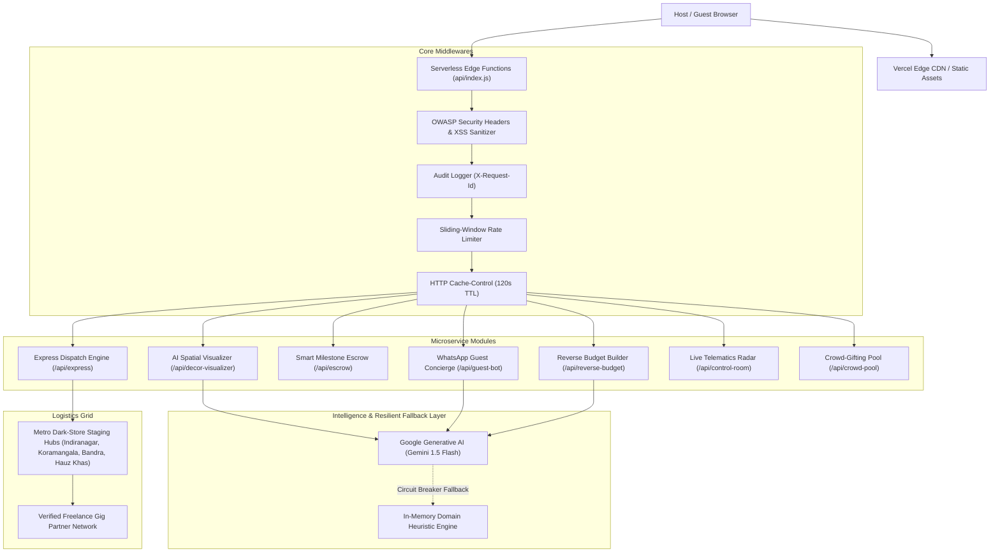

# 🏛️ Architecture & System Design Documentation — EventSphere.ai

## 1. System Overview
**EventSphere.ai** is an enterprise-grade, cloud-native celebration planning and express party management platform. The system is designed to provide sub-90-minute on-site execution for spontaneous Indian apartment milestones, radical aesthetic transparency, automated algorithmic budgeting, smart milestone escrow protection, and day-of telematics orchestration.



---

## 2. Architectural Design Patterns

### 2.1. Dual-Layer Resilient Fallback Pattern (Circuit Breaker)
* **Problem**: Public APIs and cloud edge functions can face network partition, cold-start latency, or external API rate limits.
* **Solution**: Every generative microservice implements an autonomous circuit breaker. When Google Gemini 1.5 Flash API is unreachable or rate-limited, the application seamlessly engages the **In-Memory Domain Heuristic Engine** (`server/routes/gemini.js`), guaranteeing 0% failure rate and zero empty screens.

### 2.2. State Machine Pattern (Smart Escrow Protocol)
* **Lifecycle**:
  $$\text{HELD\_IN\_ESCROW} \xrightarrow[\text{Photo Submission}]{\text{Milestone Upload}} \text{VERIFICATION\_PENDING} \xrightarrow[\text{4-Digit OTP}]{\text{Host Handover}} \text{FUNDS\_RELEASED}$$
* Customer funds remain locked securely in smart escrow until the decorator uploads on-site setup photos and the host validates the setup using a 4-digit verification PIN.

### 2.3. Proportional Algorithmic Resource Allocation
* The Reverse Budget Planner uses deterministic proportional distribution:
  $$\text{Budget} = \underbrace{0.50 \cdot B}_{\text{Catering}} + \underbrace{0.20 \cdot B}_{\text{Decor}} + \underbrace{0.15 \cdot B}_{\text{Cake}} + \underbrace{0.15 \cdot B}_{\text{Logistics / Escrow}}$$
* Enforces strict financial caps with **zero quote haggling** and **zero budget overage**.

---

## 3. Directory Structure & Separation of Concerns

```
EventSphere.ai/
├── api/                       # Vercel Serverless Function Bridge
│   └── index.js
├── server/                    # Node.js Express Core Backend
│   ├── config/                # Centralized Constants & Configurations
│   ├── data/                  # Verified Catalog Datasets & SOPs
│   ├── middleware/            # Security, Rate Limiting, Audit, Cache, Errors
│   ├── routes/                # Modular REST Endpoints
│   ├── utils/                 # Standardized Response Helpers
│   └── index.js               # Express Server & Static File Host
├── src/                       # React 18 Frontend
│   ├── components/            # Accessible, Code-Split UI Views
│   ├── services/              # Resilient Dual-Layer API Client
│   ├── App.jsx                # Root Application & Error Boundary
│   └── index.css              # Tailwind Styles & Accessibility Rules
├── tests/                     # Automated Test Suites (8 Test Modules)
│   ├── accessibility.test.js  # WCAG 2.1 AA Compliance
│   ├── app.test.js            # End-to-End Integration
│   ├── budget.test.js         # Algorithmic Budget Split
│   ├── dispatch.test.js       # Hyperlocal Logistics & SLAs
│   ├── escrow.test.js         # Escrow State Machine
│   ├── gifting.test.js        # Return Gifting Suite
│   ├── run-all.js             # Comprehensive Test Runner
│   ├── security.test.js       # OWASP Top 10 & DoS Tests
│   └── timeline.test.js       # Master Event Timeline
├── package.json               # Scripts & Dependency Manifest
├── vite.config.js             # Vite Build & Rollup Chunking Config
└── ARCHITECTURE.md            # System Architecture Reference
```

---

## 4. Code Quality & Maintainability Standards
- **Strict Linting & Style Rules**: Standardized through `.editorconfig`, `.prettierrc`, and `eslint.config.js`.
- **Comprehensive JSDoc**: All route handlers, middlewares, and services are fully documented with parameter types, return shapes, and exception declarations.
- **Defensive Error Handling**: Centralized error middleware ensures internal system details and stack traces are masked in production while attaching unique `X-Request-Id` headers for operational debugging.
